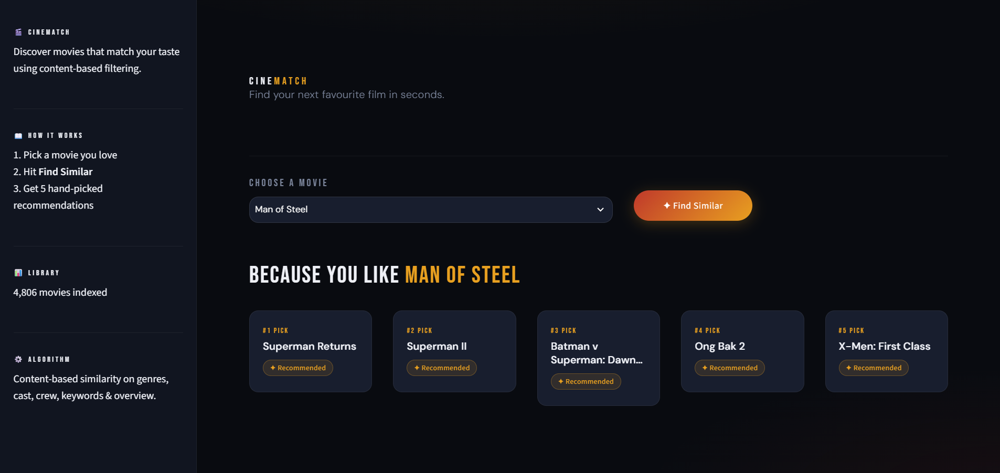

# 🎬 CineMatch – Movie Recommender System

A **content-based movie recommender** built with Python, scikit-learn and Streamlit. Pick a movie you like, and CineMatch suggests similar ones using a **K-Nearest Neighbors (KNN)** model.



---

## 🚀 Features

✅ Content-based recommendations using genres, keywords, cast, director and plot

✅ KNN model with cosine distance to find the closest movies

✅ Built on the TMDB 5000 movies dataset

✅ Clean dark-themed web app made with Streamlit

✅ Ready to run: the trained model files are already included

---

## 🧠 How It Works

1. **Data preparation:** merged `tmdb_5000_movies.csv` and `tmdb_5000_credits.csv`, kept only the useful columns and removed rows with missing data
2. **Feature extraction:** pulled out genres, keywords, the top 3 cast members and the director
3. **Cleaning:** removed spaces in names (e.g. `Sam Worthington` → `SamWorthington`) so first and last names are not treated as separate words
4. **Tags:** combined overview, genres, keywords, cast and crew into one `tags` column per movie
5. **Vectorization:** used `CountVectorizer` (5000 most common words, English stop words removed) to turn each movie into a vector
6. **KNN model:** fitted `NearestNeighbors` with cosine distance on the movie vectors
7. **Recommendation:** for the movie you select, the model returns its closest neighbors as recommendations

---

## 🛠️ Tech Stack

| Tool | Purpose |
|------|---------|
| Python | Core language |
| pandas, NumPy | Data handling |
| scikit-learn | CountVectorizer and KNN (`NearestNeighbors`) |
| Streamlit | Web app interface |
| Pickle | Saving the trained model files |

---

## 📥 How to Download and Run (Step by Step)

### Step 1: Install Python
Download Python 3.10 or newer from [python.org](https://www.python.org/downloads/). During installation, **tick the "Add Python to PATH" checkbox**.

### Step 2: Download the project
Choose one option:

- **Option A (no Git needed):** click the green **Code** button at the top of this repo, then **Download ZIP**, and extract it
- **Option B (with Git):**
  ```bash
  git clone https://github.com/nisashammi33-collab/Movie-Recommender.git
  ```

### Step 3: Open the project folder
Open a terminal (or VS Code terminal) inside the project folder:
```bash
cd Movie-Recommender
```

### Step 4: Install the required libraries
```bash
python -m pip install pandas numpy scikit-learn streamlit
```

### Step 5: Run the app
```bash
python -m streamlit run app.py
```
Your browser will open automatically. If not, go to **http://localhost:8501**.

### Step 6: Get recommendations 🎉
Choose a movie from the list and click the recommend button to see similar movies.

---

## 🔁 (Optional) Retrain the Model Yourself

The trained files are already in the repo, so you can skip this. If you want to rebuild them:

1. Extract `archive.zip` so you have an `archive` folder containing the two TMDB CSV files
2. Install Jupyter support: `python -m pip install ipykernel`
3. Open `model_building.ipynb` in VS Code or Jupyter
4. Run all cells in order
5. These files are created automatically:
   - `movie_list.pkl` – processed movie list
   - `vectors.pkl` – movie vectors
   - `knn_model.pkl` – trained KNN model

---

## 📁 Project Structure

| File | Description |
|------|-------------|
| `app.py` | Streamlit web app |
| `model_building.ipynb` | Notebook that builds the model |
| `movie_list.pkl` | Processed movie data |
| `vectors.pkl` | Movie vectors |
| `knn_model.pkl` | Trained KNN model |
| `archive.zip` | TMDB 5000 dataset |
| `CINEMATCH.png` | App screenshot |

---

## 👩‍💻 Author

**Nisa Shammi** – BCA student, Don Bosco College, Kottiyam

🔗 [LinkedIn](https://www.linkedin.com/in/nisa-shammi-381086394/) · 💻 [GitHub](https://github.com/nisashammi33-collab)

⭐ If you like this project, consider giving it a star!